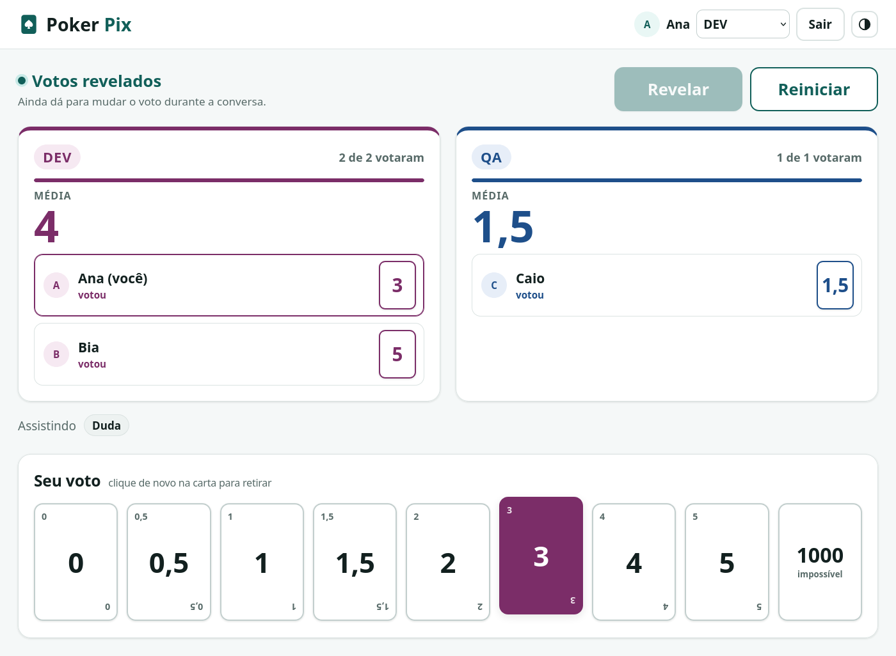
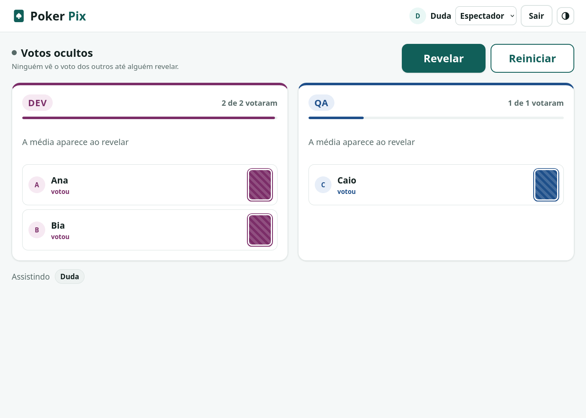
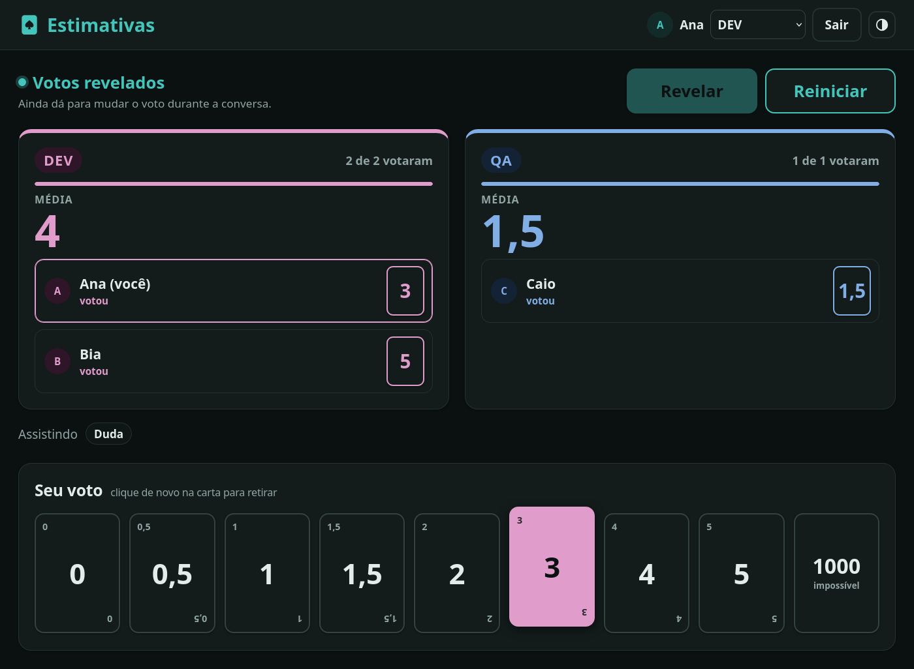
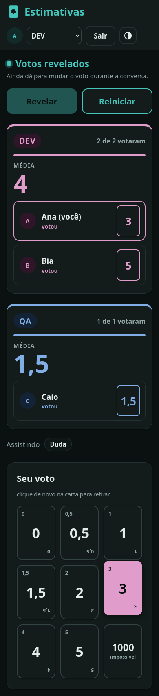

# Estimativas

Estimativa de tarefas em equipe, no estilo *planning poker*. Cada tarefa recebe
duas estimativas independentes: os DEVs estimam o tempo de desenvolvimento e os
QAs estimam o tempo de testes.

**Acesse:** <https://ralfguth.github.io/estimativas/>



## O problema

Desenvolver e testar são trabalhos diferentes, e cada um tem o seu tempo. Uma
estimativa única para a tarefa mistura as duas coisas, e quem planeja a sprint
perde a noção de quanto vai custar cada parte. Além disso, quem vota depois de
ver o voto do colega tende a copiar (o efeito de ancoragem).

O Estimativas resolve as duas coisas:

- **Dois painéis lado a lado.** DEV estima o desenvolvimento e QA estima os
  testes, cada painel com a sua própria média.
- **Voto secreto de verdade** até alguém clicar em Revelar. Não é só a tela que
  esconde, o servidor recusa entregar o voto alheio.

## Como funciona

1. A pessoa entra com e-mail e senha. No primeiro acesso, ela mesma cria a
   conta, e "Esqueci minha senha" resolve o resto. Não depende de conta Google,
   o que evita bloqueios de redes corporativas. Só passam os domínios e e-mails
   que estão na lista de acesso.
2. Escolhe o papel: **DEV**, **QA** ou **Espectador** (acompanha sem votar).
3. Vota numa das cartas: 0, 0,5, 1, 1,5, 2, 3, 4, 5 ou 1000 (impossível de
   estimar).
4. Todos veem em tempo real quem já votou, com a carta virada.
5. **Revelar** vira as cartas e mostra a média de DEV e a de QA. O 1000 fica
   fora da média e aparece contado à parte.
6. O voto pode mudar a qualquer momento, inclusive depois de revelado, porque é
   quando o time conversa sobre os números. A média acompanha assim que o
   servidor confirma.
7. **Reiniciar** zera os votos e esconde tudo para a próxima tarefa.

Quem passa mais de 12 horas sem votar sai da sala sozinho. Não há histórico de
votações: a sala guarda só o mínimo para funcionar.

| Votos ocultos | Tema escuro | Celular |
|---|---|---|
|  |  |  |

## Arquitetura

O projeto não tem servidor próprio, e roda inteiro em planos gratuitos.

```
Navegador (HTML, CSS e JavaScript puros)
   │  e-mail e senha         │  leitura e escrita em tempo real
   ▼                         ▼
Firebase Authentication   Firebase Realtime Database
                             └─ regras de acesso (o "back-end")
Hospedagem: GitHub Pages
```

- **Sem framework e sem etapa de build.** A página é HTML, CSS e módulos
  JavaScript nativos, servidos como estão. O SDK do Firebase vem por CDN.
- **As regras do banco fazem o papel do back-end.** Elas exigem e-mail
  da lista de acesso, deixam cada pessoa escrever só o próprio voto,
  aceitam só as cartas do baralho e só liberam a leitura dos votos depois do
  Revelar.
- **A lista de acesso não é pública.** O repositório guarda só um modelo das
  regras. A lista real fica num arquivo local fora do git, e um script junta as
  duas coisas na hora de publicar. Assim o código pode ser aberto sem revelar
  quem pode entrar.
- **A tela só mostra o que o servidor confirmou.** O Firebase costuma aplicar
  uma alteração na tela antes de o servidor aceitar, para parecer rápido. Aqui,
  cada ação (votar, trocar de papel, revelar, reiniciar) bloqueia a tela com um
  aviso de espera e só atualiza depois da confirmação. Sem resposta, a tela
  continua bloqueada e oferece recarregar, sem nunca mostrar algo que o servidor
  não aceitou.
- **A lógica da sala é um módulo puro** (`src/room.js`): recebe os dados do banco
  e devolve o que a tela mostra (painéis, médias, quem expirou). Sem Firebase
  dentro dele, o que deixa o módulo fácil de testar.

## Segurança

O código da página é público, como em todo site, então nada sensível fica nele.

- A configuração do Firebase na página não é senha, só identifica o projeto. A
  chave está limitada a funcionar apenas a partir do endereço do site.
- Toda decisão de acesso acontece no servidor. Mesmo pedindo os dados direto ao
  banco pelo console do navegador, quem não está na lista ou tenta ler votos
  antes do Revelar recebe "permissão negada". Os testes cobrem esses casos.
- O e-mail não é confirmado no cadastro, por escolha: a sala é uma ferramenta
  interna de baixo risco e o plano gratuito limita bastante os e-mails. Por isso
  o servidor confere o domínio do e-mail, mas não prova que a pessoa é dona
  daquele endereço. Quem tiver a conta tomada recupera pelo "Esqueci minha
  senha", que manda o link para a caixa de entrada verdadeira.
- Arquivos de credencial (chave de conta de serviço, `.env`) estão bloqueados no
  `.gitignore`. O projeto não precisa de nenhum deles.

## Testes

O desenvolvimento seguiu testes primeiro nas partes em que um erro seria
silencioso: o cálculo da sala, o sigilo do voto e o filtro de acesso.

```sh
npm test            # lógica da sala e montagem das regras
npm run test:rules  # regras de acesso, no emulador do Firebase (precisa de Java)
npm run test:e2e    # ponta a ponta no navegador, contra os emuladores
```

Os testes de ponta a ponta usam o Firefox do Playwright. Na primeira vez, rode
`npx playwright install firefox`.

- **Lógica da sala:** média por painel, 1000 fora da média, expiração de 12
  horas, voto alheio nunca exposto antes do Revelar.
- **Montagem das regras:** só domínios e e-mails exatos da lista passam,
  imitações como `falsoexemplo.com.br` ou `exemplo.com.br.outro.com` não.
- **Regras de acesso:** rodam no emulador oficial do Firebase com usuários
  simulados, de dentro e de fora da lista.
- **Ponta a ponta:** o navegador roda contra os emuladores, cobrindo o login
  (criar conta, entrar, senha errada, conta repetida, esqueci minha senha e
  e-mail fora da lista), a troca de papel e uma votação completa com quatro
  pessoas ao mesmo tempo.
- **Servidor lento:** com a conexão da página desligada, o teste confere que
  nem o voto nem a troca de papel aparecem na tela antes de o servidor
  confirmar, e que tudo atualiza quando a conexão volta.

## Design

- Moldura em verde-azulado escuro, com o painel DEV em ameixa e o QA em
  azul-marinho. Ameixa e azul vêm das famílias de cor da paleta Okabe-Ito, que
  pessoas com daltonismo conseguem distinguir. A cor nunca é a única pista: os
  painéis têm nome escrito.
- Todo texto passa do nível AA de contraste (4,5:1), nos temas claro e escuro.
  Texto principal, números e cores dos painéis ficam perto de 7:1 ou acima.
- Interface grande, pensada para ficar projetada na sala ou compartilhada na
  chamada.
- Cartas viradas com padrão listrado enquanto o voto está oculto, e giro ao
  revelar. A animação some para quem pede movimento reduzido no sistema.
- Funciona no celular.

## Rodar localmente

Sem projeto Firebase, só com os emuladores:

```sh
npm install
echo "exemplo.com.br" > allowed.txt
npm run build:rules
npx firebase emulators:start --only database,auth --project demo-estimativas
npm run serve
```

Abra `http://localhost:8080/?emulador` e, no console do navegador, entre com
`emulatorLogin('nome@exemplo.com.br')`.

## Publicar a sua própria sala

1. Crie um projeto no [Firebase](https://console.firebase.google.com) (plano
   gratuito). Em **Authentication**, ative **E-mail/senha** e adicione o
   endereço do seu site aos domínios autorizados.
2. Crie o **Realtime Database** e registre um app web. Copie a configuração para
   `firebase-config.js`.
3. Crie `allowed.txt` com um domínio ou e-mail exato por linha e publique as
   regras: `npm run deploy:rules -- --project ID-DO-PROJETO`.
4. No Google Cloud, limite a chave do navegador ao endereço do seu site.
5. Publique o repositório no GitHub Pages.

A cada mudança de CSS ou JavaScript, suba o número `?v=` em `index.html` e nos
imports de `app.js`. Isso evita que o navegador misture arquivo novo com antigo
guardado em cache.
